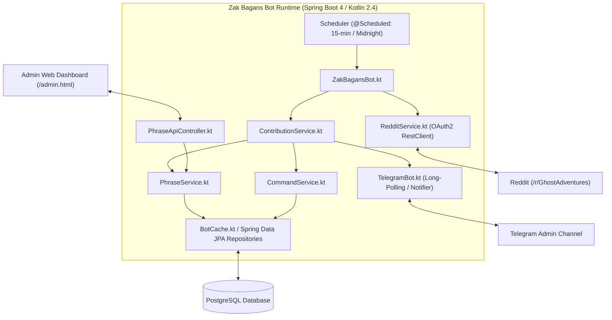

# Zak Bagans Bot - AI Agent Specification Guide

This directory contains technical and functional specifications designed for AI coding agents and developers working on
**Zak Bagans Bot**.

---

## 1. System Overview & Architecture

Zak Bagans Bot is a Spring Boot application running on Kotlin 25 / JVM 25 that interacts with the Reddit API and
Telegram Bot API. It monitors [r/GhostAdventures](https://www.reddit.com/r/GhostAdventures/) for submissions and
comments, replies with themed Zak Bagans quotes, handles administrative commands from the bot author, and reports
telemetry via Telegram.

---

## 2. Core Codebase Map

| Subsystem              | Primary Source Files                                                                               | Primary Test Files                                                                                | Specification File                                               |
|:-----------------------|:---------------------------------------------------------------------------------------------------|:--------------------------------------------------------------------------------------------------|:-----------------------------------------------------------------|
| **Engine & Reddit**    | `ZakBagansBot.kt` `service/RedditService.kt` `service/ContributionService.kt`              | `ZakBagansBotTest.kt` `service/RedditServiceTest.kt` `service/ContributionServiceTest.kt` | [bot-engine.md](bot-engine.md)                                   |
| **Phrases & Quotes**   | `service/PhraseService.kt` `phrases/Phrase.kt` `phrases/*.kt`                              | `service/PhraseServiceTest.kt`                                                                    | [phrase-system.md](phrase-system.md)                             |
| **Author Commands**    | `service/CommandService.kt`                                                                        | `service/CommandServiceTest.kt`                                                                   | [commands.md](commands.md)                                       |
| **Telemetry & Alerts** | `TelegramBot.kt` `config/TelegramProperties.kt`                                                | `TelegramBotTest.kt`                                                                              | [telemetry-and-notifications.md](telemetry-and-notifications.md) |
| **Web API & Security** | `controller/PhraseApiController.kt` `config/SecurityConfig.kt` `config/UserInitializer.kt` | `controller/PhraseApiControllerTest.kt` `controller/GlobalExceptionHandlerTest.kt`            | [api-and-security.md](api-and-security.md)                       |
| **Data & Persistence** | `db/entity/*.kt` `db/repo/*.kt` `db/BotCache.kt` `db/PhraseType.kt`                    | `db/PhraseTypeTest.kt` `db/PhraseTypeConverterTest.kt`                                        | [data-models.md](data-models.md)                                 |

---

## 3. Strict System Invariants for AI Agents

When modifying this repository, AI agents must preserve the following non-negotiable rules:

1. **No Loops on Bot Comments**: The bot MUST NEVER evaluate its own comments (`comment.author == BotUsername`) for
   quotes or mentions to prevent infinite reply loops.
2. **Author Isolation**: Comments authored by `AuthorUsername` (`Mr_Bean355`) MUST NEVER receive regular quote replies.
   They are reserved exclusively for administrative commands in `CommandService`.
3. **No Direct Replies Without Ignored Checks**: Always check `isAuthorIgnored()` before searching for phrases or
   posting replies.
4. **URL Neutralization**: Any URLs in incoming post or comment text MUST be stripped using `UrlRegex` before keyword
   scanning so links do not trigger replies.
5. **Least-Used Rotation**: Quotes must ALWAYS be selected based on lowest usage count within their `PhraseType`. Newly
   added quotes must initialize their usages to the minimum existing usage count for that type.
6. **Parentheses Escaping**: All quote sources MUST escape closing parentheses
   (`source.replace("(", "\\(").replace(")", "\\)")`) before markdown formatting to prevent broken Reddit superscript.
7. **String Resource Externalization**: User-facing Reddit and Telegram messages MUST be stored in
   `src/main/resources/strings.properties` (and mirrored in `src/test/resources/strings.properties`), accessed via
   `getString()`. Never hardcode formatted messages in Kotlin code.
8. **Test Execution**: Always run `./gradlew test` to verify changes before completing tasks.

---

## 4. AI Agent Workflow Recipes

### Recipe A: Adding a New Phrase Type

1. Add new enum entry to `com.github.mrbean355.zakbot.db.PhraseType` with the next available integer ID.
2. Create a new `com.github.mrbean355.zakbot.phrases.*Phrase` component extending `Phrase`. Set `priority` and implement
   `getReplyChance(message: String): Float`.
3. Update `Phrase.type()` mapping in `PhraseType.kt`.
4. Update admin HTML dropdown in `src/main/resources/static/admin.html` and `index.html`.
5. Update tests in `PhraseTypeTest.kt` and `PhraseTypeConverterTest.kt`.

### Recipe B: Adding a New Author Command

1. Add command parsing logic in `CommandService.processAuthorCommand()`.
2. Add necessary repository/cache methods in `BotCache` or `RedditService`.
3. Add response strings to `src/main/resources/strings.properties` and `src/test/resources/strings.properties`.
4. Document the command in [commands.md](commands.md) and [README.md](../../README.md#special-commands).
5. Add unit tests in `CommandServiceTest.kt`.
